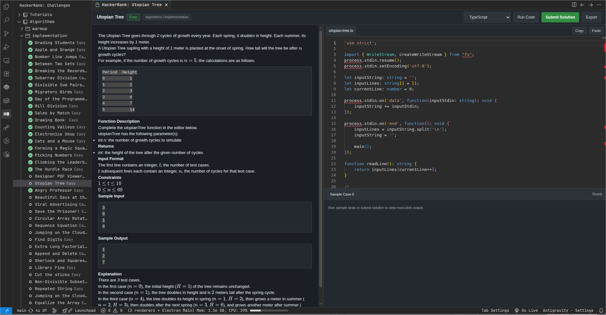

# HackerRank Native for VS Code & Antigravity

[](https://marketplace.visualstudio.com/)
[](https://opensource.org/licenses/MIT)

**HackerRank Native** is a lightweight, cloud-native VS Code and Antigravity IDE extension that allows you to browse, code, test, and submit HackerRank challenges directly within a unified workbench — without touching your local file workspace or installing local language compilers.

---



## ✨ Features

- **Single-Window Hallmark Workbench**:
  - **Problem Statement (Left Pane)**: Formatted challenge descriptions with KaTeX mathematical notation, difficulty tags, and track/chapter breadcrumbs.
  - **Embedded Monaco Editor (Right Pane Top)**: Full-featured code editor with syntax highlighting, automatic indentation, auto-save to global extension sandbox, and bidirectional clipboard copy/paste bridge (`Ctrl+C`/`Cmd+C`, `Ctrl+V`/`Cmd+V`).
  - **Interactive Test Console (Right Pane Bottom)**: Test case cards displaying compiler input, expected output, actual output, runtime error logs, and evaluation verdict banners.
- **Dialect & Multi-Language Support**:
  - **SQL Family**: MySQL, Oracle SQL, MS SQL Server (T-SQL), IBM DB2.
  - **C / C++**: C, C++14, C++20.
  - **Python**: Python 3, PyPy, PyPy 3.
  - **General Purpose**: Java, C#, Go, Rust, Ruby, PHP, Swift, Kotlin, TypeScript, JavaScript, Bash / Shell, Scala, Clojure, Perl, R, Lua, etc.
  - Automatic language boilerplate assembly with local fallback templates.
- **Explorer Tree View**:
  - Browse tracks (Algorithms, Data Structures, SQL, etc.), chapters, and challenges directly from the Activity Bar.
  - Visual checkmarks (`✓`) for solved challenges and clean difficulty indicators.
- **100% Cloud Remote Execution**:
  - **Run Code**: Triggers remote sample tests via HackerRank compile APIs.
  - **Submit Solution**: Submits your solution to the official HackerRank evaluation judge and displays testcase verdicts in real-time.
- **Export Solution**: Save your finished code to any local folder or project workspace whenever you choose.
- **Secure Session Authentication**:
  - **Session Cookie Sign In**: Direct cookie sign-in compatible with all login types (Google, GitHub, LinkedIn, Email/Password) with automatic CSRF token extraction.
  - **Secure Storage**: Credentials stored via VS Code's OS Keyring (`SecretStorage`).

---

## 🚀 Quick Start

### 1. Installation

Package and install the extension:

```bash
# Package the extension
npx @vscode/vsce package

# Install into VS Code or Antigravity
code --install-extension hackerrank-native-0.2.0.vsix
```

### 2. Sign In

<<<<<<< HEAD
1. Open HackerRank in your browser and sign in (Google, GitHub, LinkedIn, or Email/Password).
2. Open DevTools (`F12`), go to **Application** (or **Storage**) > **Cookies** > `https://www.hackerrank.com`, and copy the value of `_hrank_session`.
3. In VS Code, open the Command Palette (`Ctrl+Shift+P` or `Cmd+Shift+P`).
4. Run **`HackerRank: Sign In with Cookie`** and paste your `_hrank_session` cookie. CSRF token will be automatically extracted.
=======
1. Open [HackerRank](https://www.hackerrank.com) in your browser and sign in.
2. Open DevTools (`F12`), go to **Application** (or **Storage**) > **Cookies** > `https://www.hackerrank.com`, and copy the value of `_hrank_session`.
3. In VS Code, open the Command Palette (`Ctrl+Shift+P` or `Cmd+Shift+P`).
4. Run **`HackerRank: Sign In with Cookie`** and paste your `_hrank_session` cookie. The CSRF token is negotiated automatically.
>>>>>>> origin/feat/update-ui-ux

### 3. Solving Challenges

1. Click the **HackerRank** icon on the Activity Bar.
2. Expand a Track (e.g. *Algorithms*) and Chapter (e.g. *Warmup*).
3. Click any challenge to open the single-window workbench.
4. Select your preferred programming language from the top bar dropdown.
5. Code directly in the embedded Monaco Editor.
6. Click **Run Code** to test against sample test cases in the bottom console.
7. Click **Submit Solution** to run against hidden test cases and receive your score.
8. Click **Export** to save a copy of your solution to any local workspace folder.

---

## 🛠 Available Commands

| Command                        | Title                                         | Description                                    |
| :----------------------------- | :-------------------------------------------- | :--------------------------------------------- |
| `hackerrank.signin`            | `HackerRank: Sign In (via HackerRank Cookie)` | Sign in by pasting your session cookie.       |
| `hackerrank.checkStatus`       | `HackerRank: Check Login Status`              | Verify current active session and username.    |
| `hackerrank.logout`            | `HackerRank: Sign Out`                        | Clear saved credentials from secure storage.   |
| `hackerrank.refreshChallenges` | `HackerRank: Refresh Challenges`              | Reload tracks, chapters, and challenge status. |

---

## 🔒 Security & Privacy

- **OS Keyring Encryption**: Session cookies and CSRF tokens are encrypted via VS Code's `vscode.secrets` API (OS Keychain / Secret Service).
- **Strict Content Security Policy**: Embedded webviews enforce strict CSP headers with random cryptographic nonces, blocking inline script execution and unauthorized network endpoints.
- **Path Traversal Protection**: Track slugs, challenge slugs, and language IDs are strictly sanitized (`/^[a-zA-Z0-9_-]+$/`).
- **Workspace Isolation**: Solution files and cached outputs reside entirely in the global extension data folder, leaving your workspace undisturbed.

---

## 💻 Development & Packaging

```bash
# Install dependencies
npm install

# Compile TypeScript and bundle pruned Monaco & KaTeX assets
npm run compile

# Run full test suite with coverage
npm test

# Build production VSIX package
npx @vscode/vsce package
```

---

## 📄 License

This project is licensed under the [MIT License](LICENSE).
